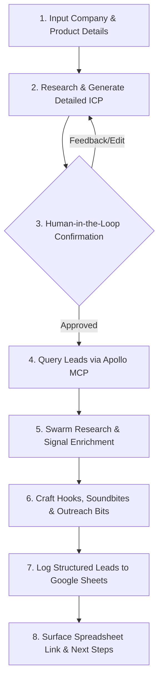

# ICP-to-Lead Prospecting Swarm Workflow

This workflow automates the B2B prospecting lifecycle from ICP strategy to outreach-ready intelligence logged in Google Sheets.

---

## Stage-by-Stage Execution Runbook

### Stage 1: Build Detailed ICP
When given a company or product to prospect for:
1. Research the company's offerings, value proposition, pricing model, and customer base.
2. Structure a comprehensive Ideal Customer Profile (ICP) containing:
   - **Firmographics**: Target industries/verticals, company size (headcount & revenue/ARR), business model (B2B SaaS, enterprise, marketplace, etc.), geographic focus.
   - **Buyer Personas**: Primary decision makers (Economic Buyers), Champions, Evaluators (titles, seniority, department).
   - **Technographics**: Complementary tech stack, competitor software, signals of technical maturity.
   - **Trigger Events & Pain Points**: Funding events, executive hiring, tool migration, scaling bottlenecks.
   - **Apollo Search Filter Specs**: Exact titles (e.g., `VP of Sales`, `Head of RevOps`), seniority levels (`director`, `vp`, `c_suite`), headcount ranges (`51-200`, `201-500`), and keyword tags.
3. Present the ICP as a structured Markdown document to the user.

### Stage 2: User Confirmation & Calibration Gate
Before making MCP queries or spending Apollo credits:
1. Present the ICP parameters clearly.
2. Ask the user for confirmation or adjustments (e.g. refining target seniority, geography, or company size).
3. Once confirmed, proceed to lead generation.

### Stage 3: Lead Discovery via Apollo MCP
1. Execute search queries using the Apollo MCP server:
   - Filter by specified job titles, seniorities, locations, and organization sizes.
   - Retrieve target candidate records:
     - Name (First & Last)
     - Current Title
     - Company Name & Domain
     - Work Email / Contact status
     - LinkedIn URL
     - Apollo ID & Location
2. Deduplicate and filter out non-target profiles.

### Stage 4: Agent Swarm Research & Signal Enrichment
Deploy an Agent Swarm (or parallel worker agents) to investigate each lead:
1. **Company Deep-Dive**:
   - Recent news, press releases, product launches, or funding rounds.
   - Tech stack indicators, hiring growth in key departments.
2. **Individual Deep-Dive**:
   - Tenure in role, past experience, public posts, published articles, podcast appearances.
   - Specific operational priorities and challenges tied to their role.
3. **Core Bullet Points**:
   - Distill research into 3–5 high-impact, factual bullet points highlighting key business triggers and personal relevance.

### Stage 5: Craft Personalized Hooks & Conversation Bits
For each enriched prospect, formulate tailored outreach assets:
- **Pattern-Interrupt Subject Line**: Specific, curiosity-evoking, spam-free.
- **Personalized Hook / Opener**: Direct reference to a factual trigger or recent milestone.
- **Value Bridge**: Clear connection between their specific pain/growth point and how our product helps.
- **Conversation Bits & Soundbites**: 1–2 punchy phrases tailored for cold calls, LinkedIn messages, or voice notes.
- **Low-Friction Call-to-Action (CTA)**: Peer-level, interest-based ask.

### Stage 6: Google Sheets Logging
1. Initialize a new Google Spreadsheet using `gsheets mutate create --title "<Company> - ICP Prospecting List"`.
2. Format the header row (bold, center-aligned, frozen row 1).
3. Append all enriched leads with full data columns.
4. Output the direct clickable link to the user: `https://docs.google.com/spreadsheets/d/<SPREADSHEET_ID>/edit`.
