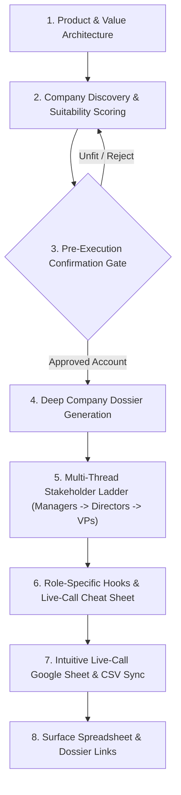

# Account-First B2B Prospecting & Multi-Thread Swarm Workflow

This skill executes an **Account-Centric B2B Prospecting Engine**. It shifts sales development from chasing isolated leads to evaluating **Company Suitability First**, generating detailed account dossiers, and mapping a 3-tier stakeholder ladder to take multiple strategic shots from bottom-up warm-up to executive sign-off.

---

## 🔒 Security & Credential Safeguard Rules (MANDATORY)

Every execution of this skill MUST strictly adhere to these security requirements:
1. **Never Call External Paid APIs Silently**:
   - Always prompt the user with their active masked key before calling Apollo search, match, or enrichment:
     > *"I am ready to run this query via Apollo using active API key `[MASKED_ACTIVE_KEY]`. Would you like to proceed with this key, or enter a different key?"*
2. **Zero Plaintext Secrets in Tracked Files**:
   - Real keys and credentials belong **only** in local, gitignored files (`.env`, `config/credentials.json`, `.agents/plugins/apollo/mcp_config.json`).
   - Tracked files must use safe placeholder strings (`YOUR_APOLLO_API_KEY_HERE`, `[MASKED_ACTIVE_KEY]`).
3. **Protect Prospect Lead Data & Company Dossiers**:
   - Generated client dossiers (`dossiers/`) and prospect CSVs (`prospects_*.csv`) must remain in gitignored paths.
4. **Pre-Commit Verification**:
   - Always run `python scripts/verify_no_secrets.py` to ensure zero credentials are committed to version control.

---

## Stage-by-Stage Operational Runbook

### Stage 1: Product Value Architecture & Targeting Boundaries
Deconstruct the product/service into operational wedges:
- **Core Value Wedge**: The primary measurable business impact (e.g., 70% reduction in charting time, 35% automated cloud cost cut).
- **Primary Operational Bottleneck**: What specific process breaks as target companies scale?
- **Technographic Prerequisites**: What systems must they have installed (e.g., Epic EHR, AWS EKS, Salesforce)?
- **Firmographic Profile**: Industry verticals, headcount sweet-spot (e.g., 500–5,000 employees), and growth velocity.

### Stage 2: Account Discovery & Suitability Scoring (Company First)
Before looking up any individuals:
1. Discover candidate accounts using free discovery tools (e.g. `apollo_organizations_lookup` or domain list).
2. Inspect the company's macro situation:
   - Headcount growth (6-month and 12-month trajectory).
   - Department headcount breakdowns (e.g., medical staff vs IT vs sales).
   - Installed technology stack and recent hiring/funding triggers.
3. Compute **Account Fit Score (1.0–10.0)** following [account_fit_framework.md](file:///e:/antigravity/prospecting/.agents/skills/icp-prospecting-swarm/templates/account_fit_framework.md):
   - **8.0–10.0 (Tier 1 Bullseye)**: Confirmed stack, high hiring growth, undeniable operational friction. -> *Proceed to Dossier & Stakeholder Ladder.*
   - **< 8.0**: Nurture or discard to preserve sales focus.

### Stage 3: Generate Company Intelligence Dossier
For every qualified account, create a centralized Markdown dossier (`dossiers/dossier_<company_slug>.md`) following [company_dossier_template.md](file:///e:/antigravity/prospecting/.agents/skills/icp-prospecting-swarm/templates/company_dossier_template.md):
- **Executive Snapshot**: Domain, size, growth rates, verified tech stack.
- **Strategic Fit Rationale**: Current operational reality vs scaling friction vs our economic wedge.
- **Objection Cheat Sheet**: Concrete answers to "We are building this internally", "We already use X", or "Not a priority".

### Stage 4: Map Multi-Thread Stakeholder Ladder
Map out 3 distinct tiers inside the company hierarchy following [multi_thread_matrix.md](file:///e:/antigravity/prospecting/.agents/skills/icp-prospecting-swarm/templates/multi_thread_matrix.md):
- **Tier 1: Ground-Truth Gatherers (Managers & Lead ICs)**
  - *Titles*: `Practice Manager`, `Clinic Supervisor`, `Engineering Manager`, `RevOps Lead`
  - *Goal*: Validate daily friction, technical reality, and warm up the account without sales resistance.
- **Tier 2: Functional Champions (Directors & Heads of Dept)**
  - *Titles*: `Director of Clinical Informatics`, `Director of Infrastructure`, `Director of RCM`
  - *Goal*: Partner on operational leverage, delivery velocity, and the internal business case.
- **Tier 3: Economic Decision Makers (VPs & C-Suite)**
  - *Titles*: `Chief Medical Officer`, `Chief Information Officer`, `VP of Engineering`, `CFO`
  - *Goal*: Executive presentation of gross margin preservation, risk reduction, and top-line ROI.

### Stage 5: Craft Role-Specific Hooks & Live-Call Cheat Sheets
For every stakeholder, generate customized assets grounded in the company's macro situation:
- **Pattern-Interrupt Hook**: Direct reference to their specific operational reality and role focus.
- **Live Call Soundbite**: 1–2 punchy phrases to say during live cold calls, voicemails, or LinkedIn notes.
- **Key Recon Question / Next Step**: The exact ask (e.g. friction question for Manager, workflow demo for Director, executive briefing for VP).

### Stage 6: Synchronize to Live-Call Google Sheet & CSV
1. Use `scripts/sheets_logger.py` to populate the standardized 17-column layout:
   - `Status`, `Company`, `Domain`, `Account Fit Score`, `Company Scenario & Triggers`, `Identified Tech Stack`, `Our Economic Wedge`, `Stakeholder Tier`, `Contact Name`, `Job Title`, `Work Email`, `LinkedIn URL`, `Role-Specific Angle`, `Pattern-Interrupt Hook`, `Live Call Soundbite & Cheat Sheet`, `Key Recon Question / Ask`, `Apollo ID`.
2. Format: Bold, centered header in dark navy (`#0F172A`) with white text, and frozen row 1 for instant scanning during calls.
3. Fallback: Automatically exports a local CSV backup if offline.
4. Output direct clickable links to the Google Sheet and the generated company dossiers.

---

## Bundled Skill Resources

- **Templates**:
  - [company_dossier_template.md](file:///e:/antigravity/prospecting/.agents/skills/icp-prospecting-swarm/templates/company_dossier_template.md): Complete blueprint for target account intelligence dossiers.
  - [account_fit_framework.md](file:///e:/antigravity/prospecting/.agents/skills/icp-prospecting-swarm/templates/account_fit_framework.md): Five-dimension account qualification and scoring framework.
  - [multi_thread_matrix.md](file:///e:/antigravity/prospecting/.agents/skills/icp-prospecting-swarm/templates/multi_thread_matrix.md): 3-tier organizational hierarchy and cross-pollination protocol.
- **Examples**:
  - [sample_dossier.md](file:///e:/antigravity/prospecting/.agents/skills/icp-prospecting-swarm/examples/sample_dossier.md): Exemplar dossier for Kelsey-Seybold Clinic.
  - [sample_multithread_matrix.csv](file:///e:/antigravity/prospecting/.agents/skills/icp-prospecting-swarm/examples/sample_multithread_matrix.csv): Anonymized 17-column live-call matrix.
- **Automated Scripts**:
  - `scripts/prospecting_workflow.py`: End-to-end account-first workflow runner.
  - `scripts/sheets_logger.py`: Google Sheets importer and formatter.
  - `scripts/verify_no_secrets.py`: Pre-commit security verification scanner.
