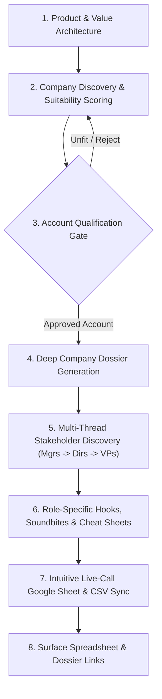

# Account-First B2B Prospecting & Multi-Thread Swarm Workflow

This workflow tackles B2B prospecting as a **Company-Suitability Challenge First**: qualifying whether target companies genuinely need our solution, generating deep account dossiers, and mapping a multi-tier stakeholder ladder to take multiple strategic shots per account.

---

## Stage-by-Stage Execution Runbook

### Stage 1: Define Value Architecture & Account Qualification Criteria
1. Clarify our product's core value wedge, target departments, and technical prerequisites.
2. Define qualification boundaries:
   - **Firmographics**: Target industry verticals, headcount range (e.g. 50–500), growth velocity.
   - **Technographics**: Required infrastructure or CRM systems.
   - **Scaling Pain**: The exact friction point that breaks as the company scales.

### Stage 2: Account Discovery & Suitability Analysis (Company First)
Before searching for any individual contact:
1. Identify candidate companies via firmographic criteria or target list.
2. Enrich target companies via Apollo organization telemetry:
   - Headcount growth (6-month and 12-month trajectory).
   - Departmental headcount breakdowns (e.g. engineering vs sales size).
   - Active installed tech stack and recent hiring signals.
3. Compute **Account Fit Score (1–10)** and evaluate the "Why Us" hypothesis.
4. Filter out low-fit accounts early to preserve credits and sales bandwidth.

### Stage 3: Generate Company Intelligence Dossier
For every approved account:
1. Generate an exhaustive Markdown intelligence file (`dossiers/dossier_<company_slug>.md`) following `templates/company_dossier_template.md`.
2. Synthesize:
   - Macro business scenario and expansion triggers.
   - Core operational bottleneck and economic wedge.
   - Live call objection handling and talk track.

### Stage 4: Map Multi-Thread Stakeholder Ladder
Map out 3 distinct tiers of stakeholders inside the approved account to enable multiple shots and bottom-up warm-up:
- **Tier 1: Ground-Truth Gatherers (Managers & Lead ICs)**
  - Validate day-to-day friction, technical reality, and warm up the account without sales friction.
- **Tier 2: Functional Champions (Directors & Heads of Function)**
  - Partner on operational leverage, developer velocity, and building the internal business case.
- **Tier 3: Economic Decision Makers (VPs & C-Suite)**
  - Executive presentation of gross margin protection, risk reduction, and top-line ROI.

### Stage 5: Craft Role-Specific Hooks & Live Call Cheat Sheets
For each stakeholder, formulate customized assets anchored in the company's macro scenario:
- **Pattern-Interrupt Cold Hook**: References their specific operational reality and role focus.
- **Live Call Soundbite**: 1–2 punchy phrases to use during cold calls, voicemails, or LinkedIn notes.
- **Next-Step Ask / Recon Question**: Tailored ask (e.g. workflow question for Manager, business benchmark for Director, executive brief for VP).

### Stage 6: Intuitive Google Sheets Logging
1. Export the multi-threaded matrix into Google Sheets using `scripts/sheets_logger.py`.
2. Format:
   - 17 intuitive columns grouping company context alongside individual stakeholder plays.
   - Bold, centered, dark-styled header with frozen row 1 for instant scanning during live calls.
3. Provide direct links to the Google Sheet and the local company dossiers.
