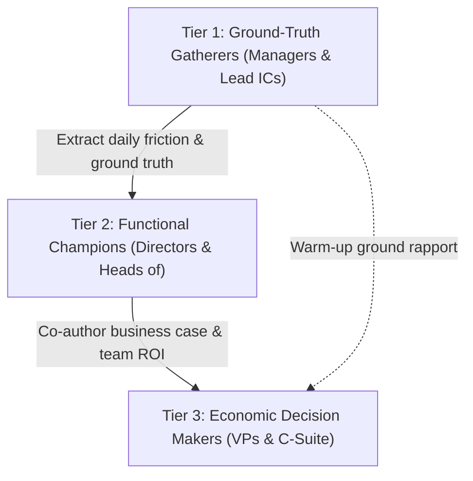

# Multi-Thread Stakeholder Ladder Framework

To maximize deal velocity and conversion, never rely on a single executive cold message. Execute a coordinated **Multi-Thread Strategy** across 3 levels of the organization hierarchy:

---

### Tier 1: Ground-Truth Gatherers (Managers & Senior ICs)
- **Titles**: `Practice Manager`, `Engineering Manager`, `RevOps Lead`, `Clinic Supervisor`
- **Objective**: Validate day-to-day friction, technical reality, and build warm rapport without sales pressure.
- **Approach**: Low-friction peer inquiry, curiosity-driven operational question.
- **Soundbite Angle**: *"How are your teams managing [specific daily headache] day-to-day?"*
- **Intelligence Payoff**: Provides direct internal quotes and concrete friction metrics to cite when approaching Directors and VPs.

### Tier 2: Functional Champions (Directors & Heads of Function)
- **Titles**: `Director of Clinical Informatics`, `Director of DevOps`, `Head of RevOps`
- **Objective**: Partner on solving team-wide bottlenecks, increasing output efficiency, and building the internal business case.
- **Approach**: Operational leverage, developer/clinician velocity, process modernization.
- **Soundbite Angle**: *"We help directors eliminate the maintenance tax, returning 30% capacity to core roadmaps with zero workflow disruption."*
- **Intelligence Payoff**: Becomes the internal project sponsor who champions the evaluation during executive reviews.

### Tier 3: Economic Decision Makers (VPs & C-Suite)
- **Titles**: `Chief Medical Officer`, `VP of Engineering`, `Chief Information Officer`, `CFO`
- **Objective**: Present strategic ROI, cost reduction, risk mitigation, and top-line growth.
- **Approach**: Concise, executive-level business impact, peer benchmarks, armed with bottom-up company context.
- **Soundbite Angle**: *"Given your team's expansion, we deliver an automated 35% reduction in friction in 30 days with zero workflow risk."*
