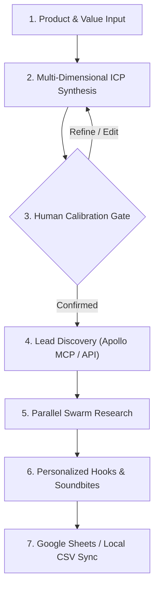

# Autonomous B2B Prospecting Swarm

An end-to-end multi-agent prospecting engine for B2B sales development. It formulates data-driven Ideal Customer Profiles (ICPs), verifies targeting with a human-in-the-loop gate, queries prospective buyers, deploys an agent swarm to extract verifiable signals, drafts hyper-personalized cold outreach assets, and synchronizes results directly to Google Sheets or local CSVs.



---

## Key Features

- **Strategic ICP Formulation**: Structures firmographics, technographics, buyer personas, buying triggers, and Apollo search filters.
- **Human-in-the-Loop Gate**: Confirms target parameters and filters before incurring API calls or credit usage.
- **Zero-Exposure Credential Architecture**: API keys and tokens are strictly kept in local gitignored configurations (`.env`, `config/credentials.json`). Pre-commit scanners verify zero secrets before any push.
- **Parallel Swarm Research**: Deploys lightweight subagents to research each account's latest milestones, growth velocity, and technical stack.
- **15-Column Intelligence Export**: Exports complete prospect profiles, pattern-interrupt hooks, phone soundbites, and cold email drafts to Google Sheets with styled headers, or saves locally to CSV/JSON.

---

## Repository Structure

```text
├── .agents/
│   ├── plugins/apollo/          # Apollo MCP plugin configurations
│   ├── rules/AGENTS.md          # Workspace operating rules
│   └── skills/                  # Autonomous prospecting swarm skill
├── config/
│   └── credentials.example.json # Safe template for local credentials
├── examples/
│   ├── sample_icp.json          # Example ICP configuration
│   ├── sample_icp.md            # Formatted ICP sample document
│   └── sample_prospects.csv     # Anonymized sample output dataset
├── scripts/
│   ├── apollo_client.py         # REST interface for Apollo with zero hardcoded keys
│   ├── build_presentation.py    # Generates slide summaries
│   ├── generate_batch_leads.py  # Sample batch processor
│   ├── prospecting_workflow.py  # Core prospecting pipeline runner
│   ├── setup_env.py             # Local environment initialization utility
│   ├── sheets_logger.py         # Google Sheets formatting and CSV import tool
│   └── verify_no_secrets.py     # Pre-commit secret scanner
├── templates/
│   ├── icp_framework.md         # 6-dimension ICP definition guide
│   └── outreach_framework.md    # Structure for hooks, soundbites, and drafts
├── .env.example                 # Environment variables template
├── .gitignore                   # Comprehensive exclusions for keys and lead data
└── requirements.txt             # Python dependencies
```

---

## Quickstart & Setup

### 1. Clone the Repository

```bash
git clone https://github.com/your-username/prospecting-swarm.git
cd prospecting-swarm
```

### 2. Configure Local Credentials Safely

Run the setup script to initialize your local `.env` and configuration files:

```bash
python scripts/setup_env.py --key YOUR_APOLLO_API_KEY
```

Alternatively, copy `.env.example` to `.env` manually:

```bash
cp .env.example .env
```

Edit `.env` to supply your credentials:

```ini
APOLLO_API_KEY=your_actual_key_here
```

> **Security Guarantee**: `.env`, `config/credentials.json`, and output lead datasets are strictly ignored by `.gitignore`. They will never be tracked or committed to GitHub.

### 3. Verify No Secrets Before Committing

You can run the built-in credential scanner at any time:

```bash
python scripts/verify_no_secrets.py
```

---

## Running the Pipeline

### Option A: Via Python CLI

Run the enrichment pipeline using sample inputs or your own JSON dataset:

```bash
python scripts/prospecting_workflow.py --company "Acme Data" --output-csv "output_leads.csv" --skip-sheets
```

To sync directly to Google Sheets:

```bash
python scripts/prospecting_workflow.py --company "Acme Data" --input-file "examples/sample_icp.json"
```

### Option B: Via Antigravity Agent Swarm

When operating within an Antigravity agent session, trigger the skill directly:
1. Provide the company name and target product URL.
2. Review and calibrate the generated ICP and Apollo filter tags.
3. Confirm execution to trigger lead discovery, swarm enrichment, and Google Sheets synchronization.

---

## Contributing

1. Fork this repository and create a feature branch.
2. Ensure `python scripts/verify_no_secrets.py` passes with zero warnings.
3. Submit a pull request.
