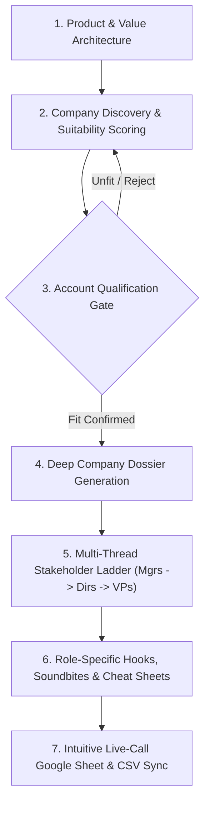

# Autonomous B2B Prospecting Swarm: Account-First & Multi-Thread Engine

An account-centric B2B prospecting engine that prioritizes **Company Suitability First** before looking for individuals. It analyzes target accounts, calculates fit scores, builds comprehensive company intelligence dossiers, maps a 3-tier stakeholder ladder (Managers -> Directors -> VPs/CXOs), crafts role-specific soundbites anchored in the company's macro scenario, and synchronizes everything to an intuitive, live-call-ready Google Sheet.



---

## Why Account-First & Multi-Threading?

1. **Company Suitability First**: Finding people at companies that don't need your product wastes outreach capacity. We qualify the company's growth, tech stack, and pain points before searching for people.
2. **Company Intelligence Dossiers**: Rather than fragmented notes on isolated individuals, every target company gets a centralized dossier (`dossiers/dossier_<company_slug>.md`) capturing macro scenario, expansion triggers, identified tech stack, and objection cheat sheets.
3. **Multi-Thread Stakeholder Ladder**: Takes multiple strategic shots at an account across 3 levels:
   - **Tier 1 (Managers / Lead ICs)**: Warm-up inquiry, operational ground truth, day-to-day friction discovery.
   - **Tier 2 (Directors / Heads of Function)**: Operational leverage, developer velocity, building the internal business case.
   - **Tier 3 (VPs / CXOs / Economic Buyers)**: Gross margin protection, risk reduction, strategic executive ROI.
4. **Intuitive Live-Call Google Sheet**: A standardized 17-column layout displaying the company's scenario, tech stack, and economic wedge alongside individual role hooks, soundbites, and next-step asks—designed for instant reference during live conversations.

---

## Repository Structure

```text
├── .agents/
│   ├── plugins/apollo/          # Apollo MCP plugin configurations
│   ├── rules/AGENTS.md          # Workspace operating rules
│   └── skills/                  # Autonomous prospecting swarm skill
├── config/
│   └── credentials.example.json # Safe template for local credentials
├── examples/
│   ├── dossiers/                # Example target company intelligence dossiers
│   ├── sample_icp.json          # Example ICP & offering configuration
│   ├── sample_icp.md            # Formatted ICP sample document
│   └── sample_prospects.csv     # 17-column sample multi-thread dataset
├── scripts/
│   ├── apollo_client.py         # REST interface with organization & stakeholder search
│   ├── build_presentation.py    # Generates slide summaries
│   ├── generate_batch_leads.py  # Sample batch processor
│   ├── prospecting_workflow.py  # Core account-first prospecting engine
│   ├── setup_env.py             # Local environment initialization utility
│   ├── sheets_logger.py         # 17-column Google Sheets formatter and CSV sync
│   └── verify_no_secrets.py     # Pre-commit secret scanner
├── templates/
│   ├── account_fit_framework.md # Company suitability and scoring framework
│   ├── company_dossier_template.md # Company intelligence dossier blueprint
│   ├── icp_framework.md         # 6-dimension ICP definition guide
│   ├── multi_thread_matrix.md   # 3-tier stakeholder ladder guide
│   └── outreach_framework.md    # Structure for hooks, soundbites, and drafts
├── .env.example                 # Environment variables template
├── .gitignore                   # Exclusions for keys, client dossiers, and lead data
└── requirements.txt             # Python dependencies
```

---

## Quickstart & Setup

### 1. Clone the Repository

```bash
git clone https://github.com/your-username/b2b-prospecting-swarm.git
cd b2b-prospecting-swarm
```

### 2. Configure Local Credentials Safely

```bash
python scripts/setup_env.py --key YOUR_APOLLO_API_KEY
```

> **Security Guarantee**: `.env`, `config/credentials.json`, client dossiers, and output lead datasets are strictly ignored by `.gitignore`. They will never be tracked or committed to GitHub.

### 3. Verify No Secrets

```bash
python scripts/verify_no_secrets.py
```

---

## Running the Pipeline

### Option A: Analyze an Account via Domain

Run account suitability analysis, generate a company dossier, and map the multi-thread ladder:

```bash
python scripts/prospecting_workflow.py --domain "cloudflow.io" --output-csv "output_cloudflow.csv" --skip-sheets
```

To sync directly to Google Sheets:

```bash
python scripts/prospecting_workflow.py --domain "cloudflow.io"
```

### Option B: Via Antigravity Agent Swarm

When operating within an Antigravity agent session:
1. Provide the target company domain or target vertical.
2. The agent qualifies the company, calculates the fit score, and generates the company dossier.
3. Review and approve the account to automatically discover the multi-tier stakeholder ladder and sync to Google Sheets.

---

## Contributing

1. Fork this repository and create a feature branch.
2. Ensure `python scripts/verify_no_secrets.py` passes with zero warnings.
3. Submit a pull request.
