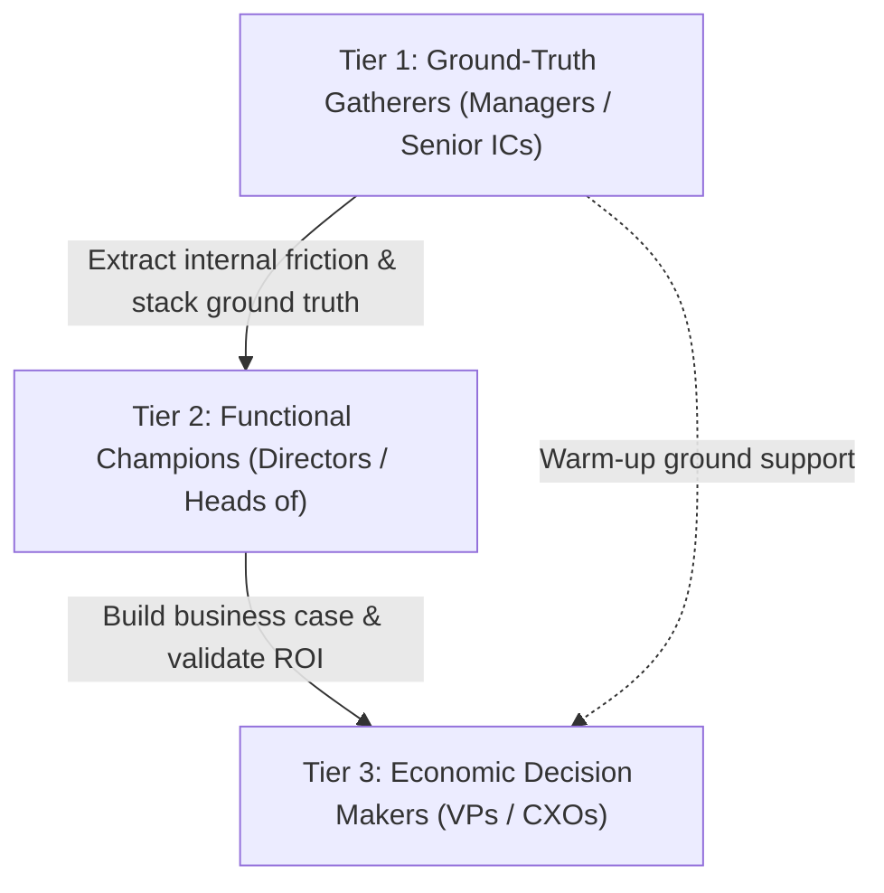

# Multi-Thread Stakeholder Ladder Framework

Once an account is qualified, never rely on a single cold message to one executive. Execute a coordinated **Multi-Thread Strategy** across the organizational hierarchy to gather ground truth, build internal momentum, and close the decision maker.

---

## The 3-Tier Stakeholder Ladder

---

### Tier 1: Ground-Truth Gatherers (Managers & Lead ICs)
- **Titles**: `Engineering Manager`, `DevOps Lead`, `RevOps Manager`, `Sales Manager`, `Lead Architect`
- **Objective**: Uncover ground reality, validate actual pain points, discover tool frustration, and warm up the account without sales pressure.
- **Approach**: Low-friction peer inquiry, curiosity-driven exchange.
- **Soundbite Angle**: *"I saw your team is running [Tool/Stack]—how are your engineers managing [specific daily headache] right now?"*
- **The Intelligence Payoff**: Provides direct internal quotes and concrete friction metrics to cite when approaching Directors and VPs.

### Tier 2: Functional Champions (Directors & Heads of Function)
- **Titles**: `Director of Infrastructure`, `Head of RevOps`, `Director of Product Marketing`, `Director of Platform`
- **Objective**: Partner on solving team-wide bottlenecks, increasing output efficiency, and building the internal business case.
- **Approach**: Team impact, operational leverage, process modernization.
- **Soundbite Angle**: *"Your managers mentioned [specific bottleneck] is adding 5 hours/week per rep. We've seen similar scaleups eliminate that friction with [Solution]."*
- **The Intelligence Payoff**: Becomes the internal champion who advocates for the project during executive budget reviews.

### Tier 3: Economic Decision Makers (VPs & C-Suite)
- **Titles**: `VP of Engineering`, `Chief Technology Officer`, `Chief Revenue Officer`, `VP of Sales`
- **Objective**: Present strategic ROI, cost reduction, risk mitigation, and top-line growth.
- **Approach**: Concise, high-level business impact, peer benchmarks, armed with bottom-up company context.
- **Soundbite Angle**: *"Given [Company]'s 30% team expansion and focus on [Strategic Goal], we help [similar companies] protect margins by cutting [Waste/Delay] by 35% without changing existing workflows."*

---

## Cross-Pollination Rules (Multi-Shot Protocol)

1. **Never Blab Confidentially**: Do not say "Your manager told me your system is broken." Instead say: *"From our research and speaking with platform leaders in your ecosystem, scaling teams at your stage typically face [X]..."*
2. **Sequential or Staggered Outreach**:
   - Week 1: Initiate conversational warm-up with 1–2 Managers (Tier 1).
   - Week 2: Approach Director (Tier 2) referencing observed operational priorities.
   - Week 3: Engage VP/CXO (Tier 3) with a polished value hypothesis backed by ground truth.
3. **Multi-Angle Coverage**: If a VP doesn't respond, a Director meeting can lead to an executive intro. If a Director is unresponsive, a Manager validation can substantiate an executive outreach.
